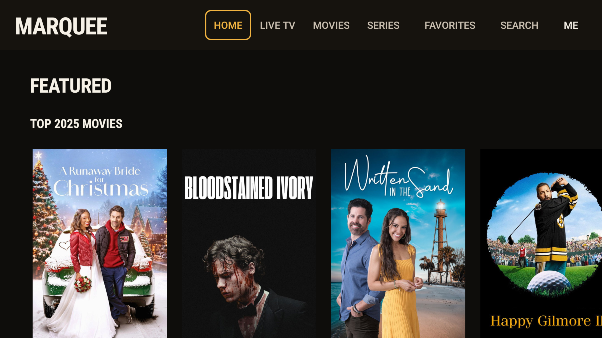
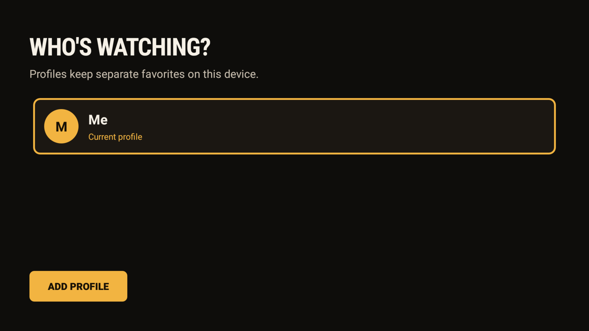
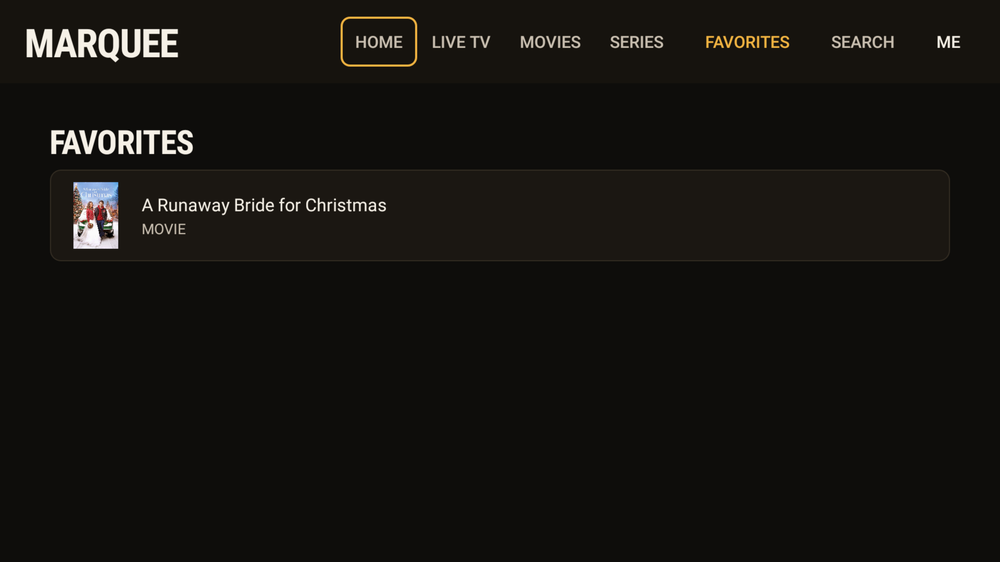

# Marquee

Marquee is a personal Android TV / Fire TV IPTV client built with Kotlin and Jetpack Media3. It targets the Xtream Codes API and is designed around a warm, cinema-style 10-foot UI rather than a generic blue media grid.

> Unofficial personal project. Not affiliated with any IPTV provider.

## Features

- **Marquee UI** — warm black/amber palette, condensed display type, artwork-first cards, and a focus ring drawn over the artwork.
- **Xtream login** — provider URL, username, and password entered once and stored in private app preferences.
- **Home rails** — featured movies, live TV, movies, and series.
- **Browse** — live channels in a 4-column grid; movies and series in a 6-column 2:3 poster grid.
- **Series detail** — backdrop, metadata, seasons, episode cards, and playback.
- **Search** — local search across the loaded live, VOD, and series catalogs.
- **Profiles** — a `Who's watching?` picker with one shared provider login. Each profile has its own favorites.
- **Favorites** — long-press **OK** on any card to add/remove it; favorites get a `★` prefix and appear in the **FAVORITES** tab.

## Screenshots

| Home | Profiles | Favorites |
|---|---|---|
|  |  |  |

The design concept is in [`firetv-player/design/redesign.html`](firetv-player/design/redesign.html). The Claude Design brief used to push the UI toward a Netflix-caliber experience, including live TV and the recommendations engine, is in [`docs/design-prompt.md`](docs/design-prompt.md).

## Build

Requirements:

- JDK 17 or newer
- Android SDK platform 35
- Android SDK build-tools
- Gradle 8.9 (a wrapper is included)

```bash
cd firetv-player
./gradlew :app:assembleDebug
```

The debug APK is written to:

```text
firetv-player/app/build/outputs/apk/debug/app-debug.apk
```

For a Fire TV, enable ADB debugging and install with:

```bash
adb install -r app/build/outputs/apk/debug/app-debug.apk
```

## Profiles and favorites

Profiles are device-local. They share the provider login and only isolate favorites:

- `ProfileStore` stores profiles and the active profile in `profiles` preferences.
- `FavoriteStore` stores each profile's list under `items_<profileId>`.
- The profile chip in the Home top bar opens the picker.
- Long-press **OK** on a Home/Browse/Search card toggles a favorite.
- Long-press a Favorites row to remove it.

If you need separate provider credentials per profile, that is a different authentication model and is not implemented here.

## Data and privacy

- `.env`, `channel-results/`, and local build artifacts are ignored.
- Credentials are entered at runtime and stored in the app's private `SharedPreferences`; they are not in this repository.
- The app bundles catalog JSON in `firetv-player/app/src/main/assets` for offline browsing. Those assets contain provider/catalog metadata but no credentials. Replace or remove them if you want a clean data set.
- The APK is a debug build; release signing is not configured.
