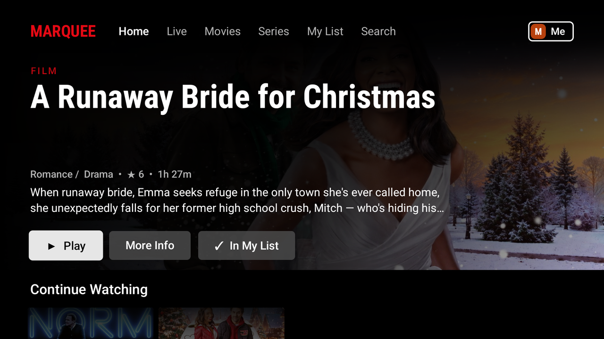
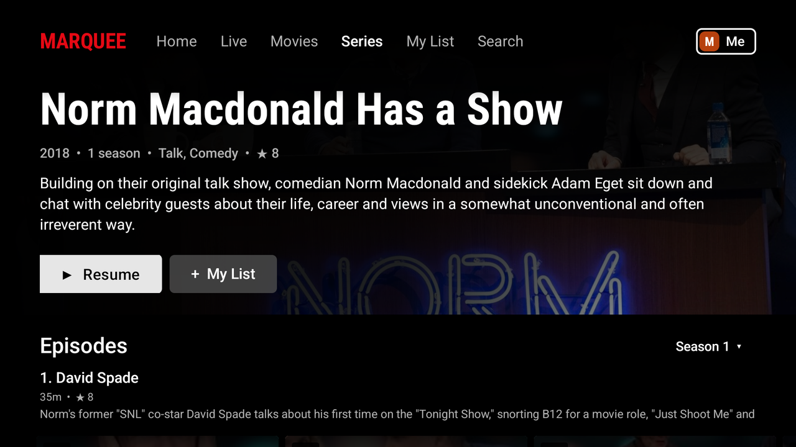
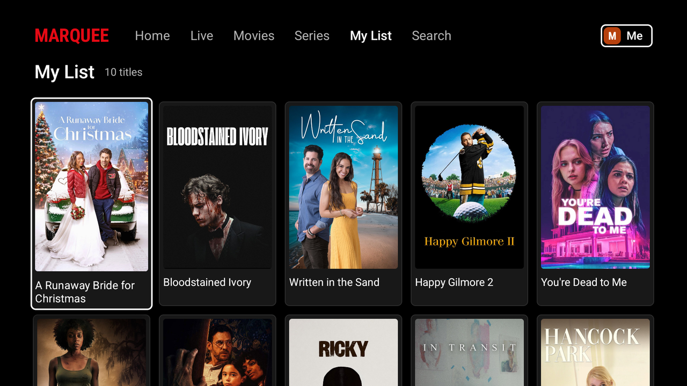

# Marquee

A personal, Netflix-inspired IPTV client for Android TV and Fire TV. Built with Kotlin and Jetpack Media3, it talks to any provider that exposes the Xtream Codes API.

> Unofficial personal project. Not affiliated with Netflix, Amazon, or any IPTV provider. No streams or credentials are included.

## Why this exists

Most IPTV apps on a TV are built like phone apps stretched onto a big screen: dense grids, tiny text, awkward remote navigation, and a UI that ignores the fact that you are sitting ten feet away. Provider-supplied apps are often worse.

Marquee started as a reaction to that. The goal was to build the opposite:

- **A living-room experience first.** Large artwork, a cinematic billboard, horizontal rails, and a focus system designed for a D-pad, not a mouse.
- **Nothing between you and the content.** Near-black ground, one accent colour, and type that reads from across the room.
- **Fast local playback state.** Profiles, My List and resume state live on the device. Optional self-hosted recommendations sync viewing evidence to your own server; no telemetry.
- **Continuity.** Stop halfway through an episode, restart the app weeks later, and pick up from the exact second — with Continue Watching and a Resume button where you expect them.
- **Stay in the player.** Previous, Next and an episode list sit in the player's control bar, so being on the wrong episode never means backing out to the series page — and finishing one rolls into the next.
- **Everything your provider gives you.** Not a curated subset: the full live channel list, every category, and the EPG your provider offers.

The result is a small, opinionated client that treats a Fire TV Stick like a cinema screen instead of a web page.

## Features

- **Netflix-inspired 10-foot UI** — pure-black ground, white type, a single red accent, artwork-first rails, white focus outlines, and smooth D-pad focus.
- **Home** — full-bleed billboard with Play / More Info / My List, then Continue Watching, Live Now, For You, Because You Watched, Top 10, New Releases, and My List rails.
- **Live TV guide** — every channel from your provider, virtualised rows, channel logos, a synced timeline with a live "now" marker, per-row EPG loaded lazily, and a category picker.
- **Series** — cinematic backdrop, season dropdown, a horizontal episode rail with stills and progress bars, an episode summary, and a Resume button for the last-watched episode.
- **Movies** — detail page with backdrop, metadata, plot, Play/Resume, My List, and More Like This.
- **Continue Watching** — per-profile playback history with resume positions, saved periodically and on exit, so force-stops don't lose your place.
- **Custom player** — 10-foot overlay with title, LIVE badge, play/pause, ±10-second seeking, progress, and auto-hiding controls.
- **Profiles** — a "Who's watching?" picker with one shared provider login. Each profile keeps its own My List, history, and recommendations.
- **My List** — a dedicated grid screen; long-press OK on any card to add or remove a title.
- **Search** — local search across the loaded live, VOD, and series catalogues, with an
  optional online fallback for titles your provider does not carry.
- **In-app updates** — checks `version.json` on launch, downloads the new APK and hands it to the system installer.
- **Recommendations** — an optional self-hosted, content-based engine using per-profile viewing evidence and TMDB metadata, with provider and online source matching. Without a server, local discovery remains available. See the [shared API and setup](docs/recommendations-api.md).

## Screenshots


*Home — cinematic billboard and artwork rails.*


*Series — season dropdown, horizontal episode rail and Resume.*


*My List — every saved title in one place.*

## Install

### Direct download

**[Download the latest APK](https://github.com/TheophilusChinomona/marquee/releases/latest/download/Marquee.apk)**

That link always points at the newest signed release.

### Fire TV / Fire OS (no ADB)

1. Install **Downloader** from the Amazon Appstore.
2. Enable installs for Downloader: **Settings → My Fire TV → Developer Options → Install unknown apps → Downloader → On**. (On older Fire OS: **Settings → Device & Software → Developer Options**.)
3. Open **Downloader**, select the URL field, enter the download link above, and choose **Go**.
4. When the download finishes, choose **Install**, then open **Marquee** from **Your Apps & Channels**.

### Fire TV via ADB (optional)

1. **Settings → My Fire TV → Developer Options → ADB Debugging → On** (enable Developer Options first by selecting **About → Device Name** seven times if needed).
2. Install over the network:
   ```bash
   adb connect <fire-tv-ip>:5555
   adb install -r Marquee.apk
   ```
3. Launch **Marquee** from **Your Apps & Channels**.

### Android TV

The same APK works on Android TV / Google TV devices (Android 5.0+):

```bash
adb install -r Marquee.apk
```

## First run

Marquee does not ship a provider or any credentials. On first launch, enter:

- your provider's base URL (`http://host:port`),
- username,
- password.

These are stored only in the app's private `SharedPreferences` on the device. They are never bundled in the APK and never leave the device.

## Optional: online sources

Marquee ships with *your* provider's catalogue and nothing else. If you want search to
also reach outside it — for a series your provider simply does not carry — there are
two ways, both off the normal path and both under **Profiles → Online sources**:

1. **A public fallback** that needs no setup and no server. It works out of the box
   and depends on somebody else's uptime.
2. **Your own resolver**: a small Node service in [`resolver/`](resolver/README.md)
   that turns a title into a playable URL on demand, so a gap in the catalogue is not
   a dead end. It is opt-in: enter the address in **Profiles → Server** and the app
   prefers it; leave it blank and the app never calls it.

```bash
cd resolver && docker compose up -d --build
curl -s http://localhost:8099/health
```

Run it on a machine on your **home network** — it must share the TV's public IP, and
[`resolver/README.md`](resolver/README.md) explains why, along with deploy, tunnel and
troubleshooting notes. Nothing about your setup is baked into the APK; the app has no
default server.

## Build from source

Requirements:

- JDK 17 or newer
- Android SDK platform 35 and build-tools
- Gradle 8.9 (the wrapper is included)

```bash
cd firetv-player
./gradlew :app:assembleDebug
```

The debug APK is written to `firetv-player/app/build/outputs/apk/debug/app-debug.apk`.

### Release builds

Release signing is read from `firetv-player/keystore.properties` (git-ignored):

```properties
storeFile=keystore/marquee-release.jks
storePassword=...
keyAlias=marquee
keyPassword=...
```

```bash
cd firetv-player
./gradlew :app:assembleRelease
```

The signed APK is written to `firetv-player/app/build/outputs/apk/release/app-release.apk`.

> Keep the keystore and `keystore.properties` out of git. Android will not install an update signed with a different key.

## How it is organised

```text
resolver/                  Optional self-hosted stream resolver (Node + Chromium)
firetv-player/
  app/src/main/
    java/com/orca/iptv/
      HomeActivity.kt        Home screen and billboard
      MarqueeHome.kt         Marquee hero and rails
      MarqueeNav.kt          Top navigation and profile chip
      MarqueeUi.kt           Shared design system (colour, type, focus)
      BrowseActivity.kt      Live / movies / series grids
      LiveGuideActivity.kt   Live TV guide, categories, EPG
      DetailActivity.kt      Movie detail
      SeriesActivity.kt      Series detail, seasons, episodes, resume
      PlayerActivity.kt      Media3 player and overlay
      MyListActivity.kt      My List grid
      SearchActivity.kt      Local search
      ProfilesActivity.kt    Profile picker
      XtreamClient.kt        Xtream Codes API client
      *Store.kt              Local prefs: profiles, favorites, history
      Recommendations.kt     On-device recommendation baseline
    res/                     Themes, layouts, drawables, launcher icons
    assets/                  Bundled catalog metadata (no credentials)
  tools/                     Catalog and allowlist helper scripts
```

The bundled JSON catalogues in `assets/` make the Home rails work offline and keep the app fast. They contain provider/catalog metadata and artwork URLs only. To build them for your own provider, see `firetv-player/tools/build_catalog.py` (it reads provider credentials from `.env`, which is git-ignored).

## Desktop app (Windows & Linux)

A native desktop edition built with **Tauri 2**, **React + TypeScript**, **Rust**, **SQLite**, and embedded **libmpv** lives under [`desktop/`](desktop/). It brings the same cinematic interface, Xtream Codes catalogue sync, local profiles, Continue Watching, episode queues, Live TV guide, and on-device recommendations to desktop machines.

See [`desktop/README.md`](desktop/README.md) for prerequisites, development commands, and Windows/Linux installer builds. Desktop builds and updates stay completely separate from the Android APK and root `version.json`.

## Privacy

- Profiles, My List and resume history are local. A separate SQLite watch ledger retains completed viewing for recommendations. With a configured server and online sources enabled, viewing evidence syncs to your own server; TMDB receives title metadata queries, not profile names or viewing durations.
- There is no analytics, tracking, or telemetry.
- Online sources are optional and off the normal path: with no server set, the app only uses
  the built-in public fallback when a search finds nothing in your catalogue.
- Live EPG and artwork are fetched from your provider and the URLs it returns.
- Provider credentials are entered at runtime and stored on the device only.
- On launch the app makes one request to this repository, for `version.json`, to see whether a newer build exists. It sends no identifiers and nothing about your usage; if the file is unreachable the check is skipped silently. See *Updates* below.

## Updates

Marquee can update itself from this repository's releases. On launch it fetches
[`version.json`](version.json), compares `versionCode` with the installed build, and only
then offers the download. The APK is saved to the app cache, checked against `sha256` when
one is published, and handed to the Android TV installer — which always asks for
confirmation. Nothing installs silently.

Code merges into the default branch (`master`, or `main` if renamed) now run the
release workflow: backend tests, signed APK build, then APK and SHA-256 manifest
published together in a GitHub release. Future builds read the release's
`version.json`; the root file remains a bootstrap for older installed versions.
Each release increments `versionCode` and the patch version automatically, unless
the prepared Gradle version is already newer. Documentation-only and bootstrap
manifest changes do not publish another APK. A failed build leaves the previous
release active. Signing material is stored in encrypted GitHub Actions secrets.
Device playback/instrumentation checks remain separate from build verification.

On Fire OS, allow it once: **Settings → My TV → Developer Options → Install unknown apps →
Marquee → On**. An update must be signed with the same key as the installed build,
otherwise Android rejects it.

## Known limitations

- Personal project, tested primarily on a Fire TV Stick 4K (Fire OS 7 / Android 7.1.2).
- Requires a provider that implements the Xtream Codes API.
- Playback depends on your provider, network, and region; some channels may not play.
- The bundled catalogue snapshots may not match your provider exactly.
- Release builds are signed with a personal key, so updates must come from this repository.
- Online search results come from a third party and are only as good as that source on the
  day; old catalogue entries frequently go missing. See [`resolver/README.md`](resolver/README.md#troubleshooting).

## Credits

- Built with [Jetpack Media3 / ExoPlayer](https://developer.android.com/media/media3).
- Design direction: "House Lights Down", later reworked into a Netflix-inspired 10-foot system.
- Identity: the MARQUEE wordmark — condensed caps, white on pure black, with a single red rule
  that the Q's descender cuts through (`mipmap-*/ic_launcher.png`, `banner.png`).

## Contributing

Contributions are welcome. See [CONTRIBUTIONS.md](CONTRIBUTIONS.md) for setup, style and pull request guidelines. The `master` branch is protected, so please open a pull request instead of pushing directly.

## License

[MIT](LICENSE) © 2026 Theophilus Chinomona

## Disclaimer

Marquee is a client only. It does not host, provide, or endorse any streams or content. You are responsible for using it with a provider you are authorised to access. Not affiliated with Netflix, Amazon, Google, or any IPTV provider.
